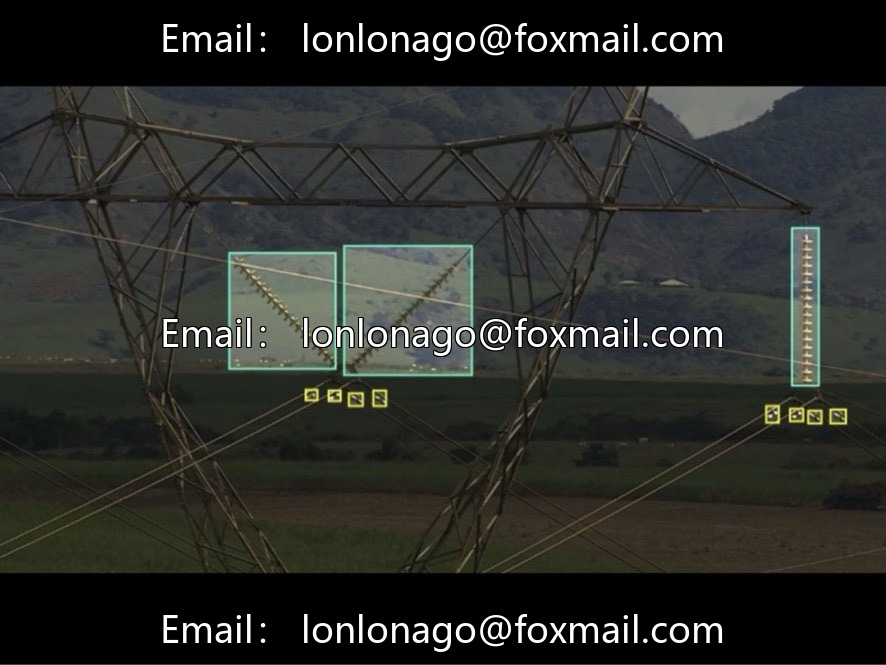
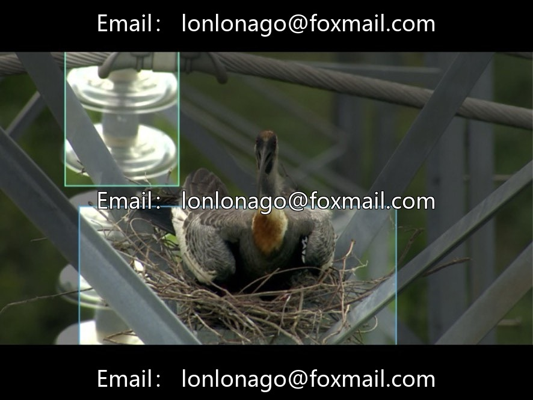
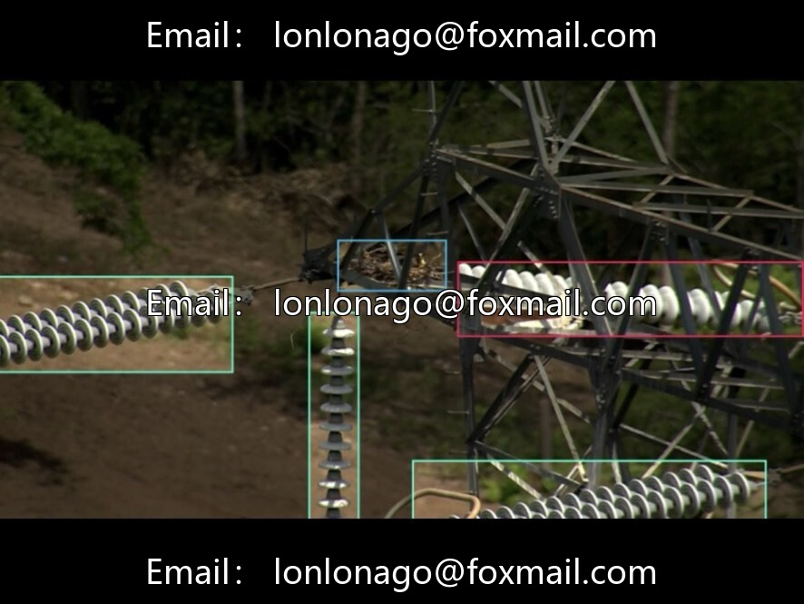
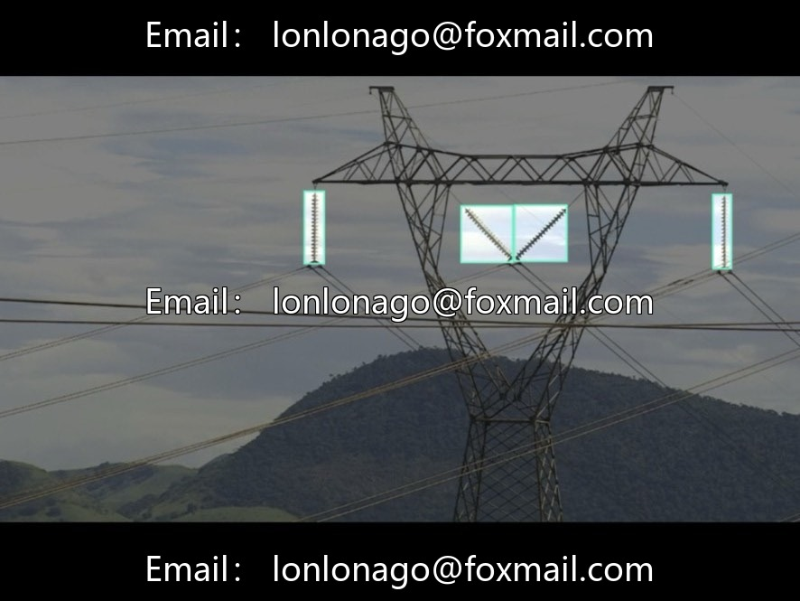
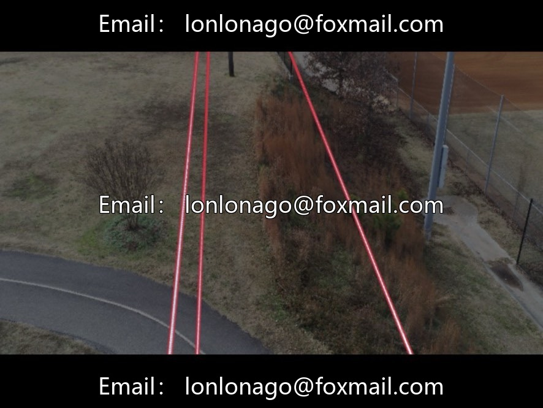
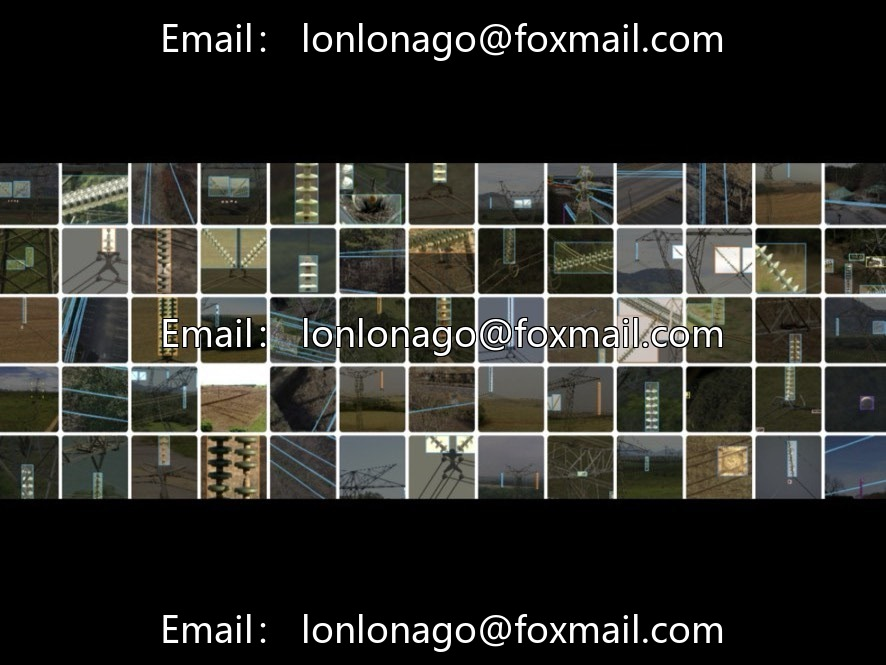

# Power Transmission Line Multi-Component Health Status Detection Dataset

## Body

Power Transmission Line Multi-Component Health Status Detection Dataset
For the intelligent inspection scenario of drone power transmission lines, this dataset contains 7300 actual images, and it is labeled in YOLO standard format. The target boxes are fully completed for the whole image, eliminating the need for secondary format conversion. It can be directly used for training YOLO series object detection models.

The dataset covers 16 categories including wires, vibration dampers (normal/defect/abnormal), insulators (normal/defect/unknown), spacers (normal/defect), towers (girder/bucket/wooden), nests, and general background. It considers three states of components: intact, faulty, and undecidable, with balanced distribution of samples across categories. The images cover different lighting conditions, weather, shooting angles, and include complex background interference from real scenes. The data closely resembles the actual working conditions on-site.

Core purpose
1. Algorithm Deployment: Implement automatic identification of line components, defect localization, and fault grading, compatible with drones for fully automated inspection.
2. Operations and Maintenance Cost Reduction: Supporting early warning of line failures, implementing tiered handling, and reducing the workload of manual field inspections.
3. Power Grid Management: Relying on data for the full lifecycle health assessment of transmission lines, assisting in operational maintenance scheduling and power grid risk management.
4. Algorithm Verification: Provide multi-category, multi-condition real-world data to test the generalization and robustness of multi-object detection models.

Applicable scenarios: Power AI defect detection research and development, drone power inspection algorithm training, smart grid intelligent operation and maintenance project implementation.

Virtual materials, once sold, are non-refundable.
Interested friends, click "I want" to proceed.

## Images

## Payment

Here is a pay link on Stripe ( https://buy.stripe.com/3cs8yP7sY87d0vu9AB ). Please contact me lonlonago@foxmail.com after funding $89, and I will send you a complete data files , thank you!

